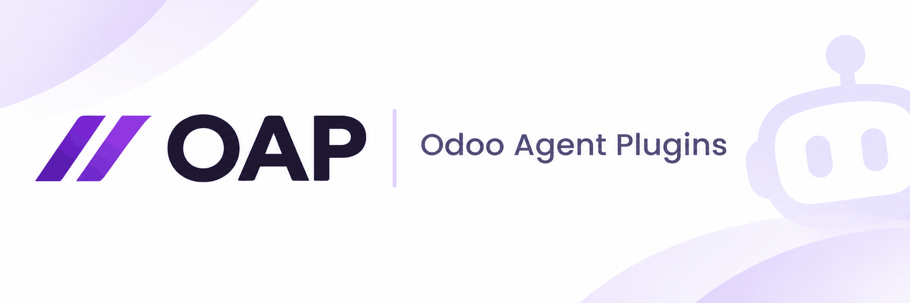

<div align="center">

# Odoo Agent Plugins

Plugins de Claude Code que llevan una tarea de Odoo de principio a fin: código y tests, push a una rama staging de Odoo.sh, verificación del build y un informe con evidencias, con salvaguardas que impiden tocar producción.

[](LICENSE)
[](https://code.claude.com/docs/en/plugins)
[](plugins/)
[](https://nodejs.org/)
[](https://www.odoo.sh/)
[](https://github.com/hachecito/odoo-agent-plugins/actions/workflows/gitleaks.yml)



</div>

## Plugins

| Plugin | Descripción |
|---|---|
| [odoosh-browser](plugins/odoosh-browser/README.md) | Tareas Odoo de principio a fin sobre una rama staging de Odoo.sh: código y tests, commit, push con confirmación, verificación de build, logs y tests (editor web de Odoo.sh con Claude in Chrome, o SSH) e informe con evidencias. |
| [odoo-squad](plugins/odoo-squad/README.md) | Squad de agentes autónomos que ejecuta una tarea documentada de principio a fin: planifica, implementa, prueba, corrige, consulta a un advisor y redacta el informe. Requiere `odoosh-browser`. |

## Requisitos

- [Claude Code](https://code.claude.com/docs) y Node.js 18 o superior.
- [Claude in Chrome](https://code.claude.com/docs/en/chrome) con sesión iniciada en Odoo.sh, para leer builds y logs y usar el editor web.
- `git` y, para las pull requests, la CLI `gh` con sesión.
- SSH a Odoo.sh es opcional y está desactivado por defecto.

## Instalación

```powershell
claude plugin marketplace add hachecito/odoo-agent-plugins      # o la ruta local de este repositorio
claude plugin install <plugin>@odoo-agent-plugins
```

## Uso básico

Preparar **una vez por repo** de módulos Odoo (pide la rama staging de Odoo.sh y comprueba Chrome, GitHub y SSH):

```
/odoosh-browser:odoo-project-setup
```

### odoosh-browser: un agente, una tarea

Cuando quieres supervisar de cerca una tarea concreta:

```
/odoosh-browser:odoo-task Corregir el cálculo de descuentos en sale_custom y añadir un test
```

Hace código y tests, commit, push a staging (con confirmación), espera el build, lee logs, ejecuta los tests en Odoo.sh y entrega un informe con evidencias.

### odoo-squad: un equipo de agentes, tarea documentada

Cuando quieres delegar la tarea completa. Se le pasa un `.md` (o una descripción):

```
/odoo-squad:squad-run tareas/descuentos.md
/odoo-squad:squad-run "Añadir campo 'referencia cliente' a sale.order y mostrarlo en la vista de lista"
```

Un planificador, un implementador, un tester, un corrector, un advisor (modelo más potente, solo para decisiones difíciles) y un redactor (borradores de mensajes) trabajan sobre las mismas salvaguardas. Requiere tener instalado `odoosh-browser`.

### Utilidades (PowerShell)

```powershell
node <plugin>\scripts\notes.js show                       # memoria del proyecto (.oap/memory.md)
node <plugin>\scripts\config.js validate                  # configuración del repo
node <plugin>\scripts\config.js set-autonomy auto         # push a staging sin confirmar (producción sigue denegada)
node <plugin>\scripts\config.js set-autonomy yolo         # además Chrome, scripts del plugin y ssh a staging sin confirmar
node <plugin>\scripts\config.js migrate                   # pasar .claude/ antiguo a .oap/
```

Los dos plugins comparten la carpeta `.oap/` del repo (excluida de git): configuración, estado de la tarea y `memory.md` con lo aprendido.

## Actualización

```powershell
claude plugin marketplace update odoo-agent-plugins
claude plugin update odoosh-browser@odoo-agent-plugins     # comprobar claude plugin list --> nueva versión
claude plugin update odoo-squad@odoo-agent-plugins
```

## Estructura

```
.claude-plugin/marketplace.json   catálogo de plugins de este repositorio
plugins/<plugin>/                 un plugin por carpeta (plugin.json, skills, agents, hooks, scripts, docs, tests)
```

## Licencia

[MIT](LICENSE) © 2026 hachecito
